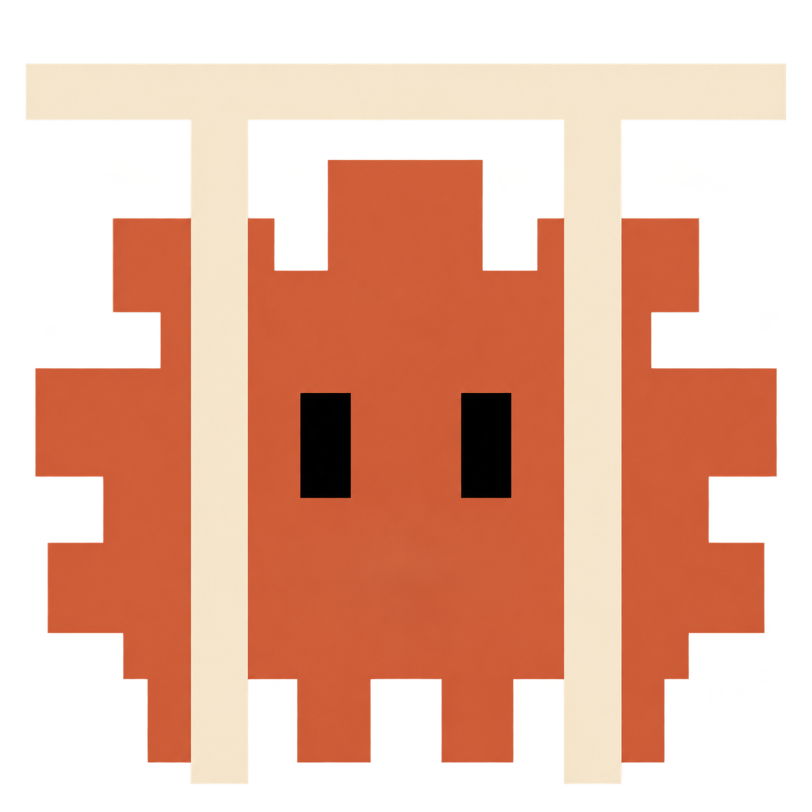
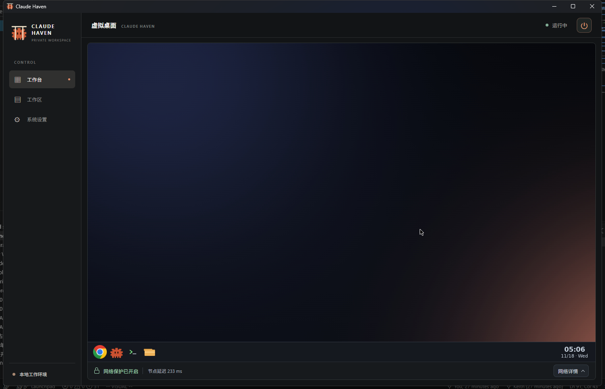
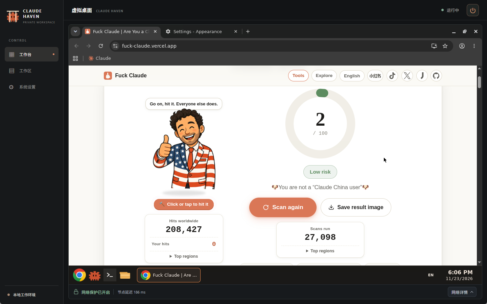

<div align="center">
  
  <h1>Claude Haven</h1>
  <p><strong>让 Claude Code 拥有自己的桌面工作区</strong></p>
  <p>在 Windows 上，把终端、浏览器与项目文件放进一张专注的 Linux 桌面。</p>
  <p>
    
    
    
    <a href="LICENSE"></a>
  </p>
  <p>
    <a href="#快速开始">快速开始</a> ·
    <a href="#核心体验">核心体验</a> ·
    <a href="#安全与数据边界">安全与数据边界</a> ·
    <a href="claude-tauri/README.md">开发说明</a> ·
    <a href="#参与项目">参与项目</a>
  </p>
</div>

---

Claude Haven 是一个面向 Claude Code 的 Windows 桌面工作台。它在 WSL2 中运行 Linux 桌面，把常用开发工具放在同一处，同时让你选择哪些项目文件夹需要与 Windows 共享。

> **v0.1.0 开发预览版** · 面向 Windows x64。macOS 和 Linux 桌面端暂不支持。

## 安装即用

从 [GitHub Releases](https://github.com/KeithMorning/ClaudeVM/releases/latest) 下载 Windows 安装包并按提示安装。安装包已包含 Linux 运行时，日常使用不需要另外安装 Node.js、Rust、Docker，也不用手动准备 Linux 镜像。

首次启动会先检查 WSL 2。电脑已有可用 WSL 2 时直接复用，不重复下载；缺少 WSL 运行引擎时，应用从微软官方地址下载并校验安装包。只有确实需要启用 Windows 组件时才会请求一次管理员授权，部分电脑需要重启后继续。离线电脑也可选择本地的受支持 WSL 安装包恢复。

安装引导由应用显示实际下载进度、校验结果和可复制诊断信息，不需要用户打开命令行。WSL 2 初始化完成后，在「系统设置」中选择 Clash / Mihomo 配置与出口节点，再在「工作区」选择共享文件夹，即可启动虚拟桌面。首次使用需要网络配置；WSL 组件只在电脑尚未具备运行条件时安装。

## 核心体验

| 一张完整桌面 | 网络保护 | 按需共享项目 |
| --- | --- | --- |
| 在同一个 Linux 桌面中使用 Claude Code、浏览器、终端和文件管理器。 | 内置 Mihomo 与 TUN。启动时验证网络保护和出口地区；保护条件不满足时拒绝进入环境。 | 选择一个 Windows 文件夹映射到虚拟桌面。文件保留在本机，虚拟桌面可直接编辑。 |
| **中文输入与复制粘贴** | **关闭后继续运行** | **本地配置** |
| 使用 fcitx5 / Rime 中文输入法，支持 Windows 与虚拟桌面之间的文本复制粘贴。 | 关闭窗口会收进系统托盘并保留会话；从托盘选择退出才会停止环境。 | Clash / Mihomo 配置在本机导入，选择出口节点后由虚拟环境使用。 |

## 运行界面



浏览器也可以直接在虚拟桌面中使用。



## 快速开始

### 从源码运行（开发者）

- Windows x64
- Node.js、Rust MSVC 工具链、C++ Build Tools 和 WebView2
- Linux 运行时镜像 `rootfs.tar.gz`（发布安装包已内置；开发时需单独准备）

### 启动开发版

```powershell
git clone https://github.com/KeithMorning/ClaudeVM.git
cd ClaudeVM\claude-tauri
npm install
```

将 `rootfs.tar.gz` 放入 `claude-tauri\runtime\`，然后运行：

```powershell
npm run dev
```

应用首次启动会准备 WSL2 环境。进入设置后，选择 Mihomo / Clash YAML、出口节点和共享工作区，再启动虚拟桌面。

运行时镜像没有随仓库提供；如果手头没有镜像，可按下方说明从源码构建。

### 自行构建运行时镜像

日常运行不需要 Docker。只有从源码构建 Linux 运行时镜像时，才需要在 Linux 或 WSL 环境中准备 Docker：

```bash
bash claude-vm/build-rootfs.sh
```

构建 Windows 安装包：

```powershell
cd claude-tauri
npm run build
```

## 安全与数据边界

- 网络守卫通过 TUN 管理虚拟环境的出站连接，并在启动时检查保护状态和出口地区。检查不通过时，环境不会被标记为就绪。
- 出口地区检查依据 IP 地理信息和 Anthropic 公布的支持地区。它不能确认用户的实际所在地、账号资格，也不能保证账号不会受到平台限制。
- 共享工作区会直接读写 Windows 上所选文件夹中的文件；请只共享你希望虚拟桌面访问的目录。
- 网络检查会向外部 IP 信息服务发起请求。检查项目、实现依据和局限见[网络检查审计](docs/network-check-audit.md)。
- 虚拟桌面与主机之间支持文本剪贴板；图片和文件请通过共享工作区传递。

## 当前支持范围

| 项目 | 状态 |
| --- | --- |
| Windows x64 桌面应用 | v0.1.0 开发预览 |
| WSL2 Linux 虚拟桌面 | 支持，仍在验证不同 Windows 环境 |
| 中文输入、双向文本剪贴板、共享文件夹 | 已实现 |
| Mihomo / TUN 网络保护与启动出口检查 | 已实现，检查边界见上文 |
| macOS | [Lima 开发模式](claude-tauri/README.md#macos-开发模式)，待实机验证 |
| Linux 原生桌面应用 | 暂不支持 |
| 正式代码签名与自动更新 | 尚未提供 |

WSL 引导目前以 Windows x64 为目标，最低系统版本按微软当前 WSL 安装文档设置为 Windows 10 build 19041；该版本下限和离线安装步骤尚待干净 Windows 实机完整验证，详见 [WSL 引导验证记录](docs/wsl-bootstrap-validation.md)。

## 项目结构

| 路径 | 内容 |
| --- | --- |
| [`claude-tauri/`](claude-tauri/) | Tauri 桌面程序、界面和运行时同步脚本 |
| [`claude-vm/vm/`](claude-vm/vm/) | Linux 桌面、网络保护脚本和资源 |
| [`tests/`](tests/) | 当前项目测试 |
| [`docs/`](docs/) | 网络检查审计与问题记录 |
| [`diagnostics/`](diagnostics/) | 只读网络诊断工具 |

## 参与项目

Claude Haven 仍在快速打磨中。遇到问题时，欢迎提交 [Issue](https://github.com/KeithMorning/ClaudeVM/issues)：请附上 Windows 版本、复现步骤和相关日志，并先移除配置文件中的节点地址、密码及其他个人信息。

## 许可

项目采用 [MIT License](LICENSE)。随附组件保留各自许可。
