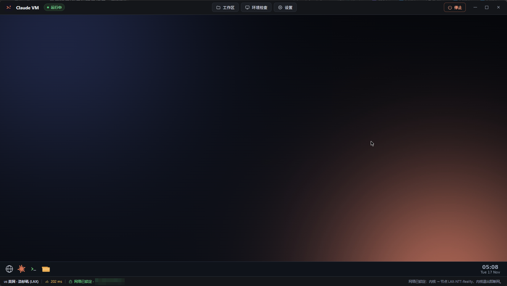

<div align="center">


# Claude VM

**在 Windows 上运行独立的 Linux 桌面，为 Claude Code 准备工作空间。**

[下载 Windows 安装包](https://github.com/KeithMorning/ClaudeVM/releases) · [使用与构建文档](doc/index.md) · [反馈问题](https://github.com/KeithMorning/ClaudeVM/issues)

[](https://github.com/KeithMorning/ClaudeVM/releases)  [](LICENSE)

</div>

Claude VM 是一个 Windows 桌面应用。它使用 WSL2 运行 Linux 桌面，将 Chrome、Claude Code、中文输入法和网络配置集中在一个工作空间中。你的文件通过共享目录在 Windows 和虚拟环境之间访问。

| 启动前 | 虚拟桌面 |
| :---: | :---: |
| <a href="doc/images/ui-idle.png"></a> | <a href="doc/images/ui-running.png"></a> |

## 当前支持

- **Windows x64**：通过 WSL2 运行，Windows 10 / 11 家庭版也可使用 WSL2。系统需要支持并启用硬件虚拟化，以及「适用于 Linux 的 Windows 子系统」「虚拟机平台」组件。首次启动时导入随安装包提供的 Linux 运行时。
- **macOS / Linux**：目前没有正式支持，也没有经过完整发布验证。仓库中保留的相关代码和历史文档不代表可用的正式版本。

## 安装与开始使用

1. 确保 Windows 已启用并安装 WSL2。可参考 [Microsoft 的 WSL 安装指南](https://learn.microsoft.com/windows/wsl/install)。
2. 从 [Releases](https://github.com/KeithMorning/ClaudeVM/releases) 下载 `ClaudeVM-Setup-2.1.0-x64.exe` 并安装。安装包目前未签名，Windows 可能提示未知发布者。
3. 打开应用，在「设置 → 网络与安全」中选择 Clash / Mihomo 格式的 YAML 文件和一个出口节点。配置文件需要包含可用节点。
4. 选择地区和共享工作区，点击「启动」。首次启动需要导入运行时；桌面出现后，可在其中打开浏览器或终端。
5. 在「网络与安全」中运行连接检查，查看网络守卫、DNS 和出口状态。

如果电脑还没有 WSL，可在应用中点击「安装 WSL2」，同意管理员授权，并按提示重启后重新检查。也可以在管理员 PowerShell 中运行 `wsl --install`。此命令要求 Windows 10 2004（内部版本 19041）及以上或 Windows 11；更旧版本请参阅 [Microsoft 手动安装说明](https://learn.microsoft.com/windows/wsl/install-manual)。Claude VM 使用自己的 WSL 发行版，首次启动时自动导入；没有可用的 WSL2 时，应用无法启动虚拟桌面。

## 功能

- **独立工作环境**：在串流桌面中使用 Chrome、Claude Code、终端和文件管理器。
- **网络连接**：读取 Clash / Mihomo YAML 中的节点，由虚拟环境内的 mihomo 使用所选节点出网。应用生成单节点配置，不沿用原文件的分流规则。
- **网络守卫**：运行时使用 TUN 和网络守卫限制直连；连接异常时可在状态栏和「网络与安全」查看状态。
- **中文输入**：内置 fcitx5 + Rime 万象拼音，支持候选词和任务栏图标。
- **地区与工作区**：可选择预设的时区、语言和共享目录；变更后按界面提示重启生效。

## 网络与隐私边界

网络检查会连接外部检测服务，并显示检查时的结果；**通过检查不等于不会泄露，也不保证 CheckCC 或其他第三方服务的评分**。浏览器行为、插件、账号、网络环境和服务端规则仍可能影响结果。请在使用前自行核对实际出口，连接或节点变化后重新检查。

共享目录中的文件可被虚拟环境访问。导出的诊断包或完整检查报告可能包含环境和网络信息，分享前请检查其内容。

## 从源码构建

需要 Node.js、npm、Windows 构建环境，以及 `claude-desktop/runtime/rootfs.tar.gz`。运行时镜像不在 Git 仓库中；构建与导出方法见 [构建与打包](doc/engineering/01-构建与打包.md)。

```powershell
cd claude-desktop
npm install
npm start            # 开发运行
npm run dist:win     # 生成 Windows x64 安装包
```

输出位于 `claude-desktop/dist/`。构建时会先同步虚拟环境脚本和界面资源。

## 项目结构

| 路径 | 内容 |
| --- | --- |
| [`claude-desktop/`](claude-desktop/) | Electron 应用、配置界面和打包脚本 |
| [`claude-vm/`](claude-vm/) | Linux 运行时、桌面配置、输入法和网络守卫 |
| [`doc/`](doc/index.md) | 架构、网络、安全边界及构建文档；部分历史文档可能已过时 |
| [`tests/`](tests/README.md) | 单元、静态和 WSL 集成测试 |
| [`build/`](build/) | 构建、验证和排障工具 |

在仓库根目录运行快速测试：

```powershell
node --test "tests/unit/*.test.js" "tests/static/*.test.js"
```

## 许可

[MIT](LICENSE)
