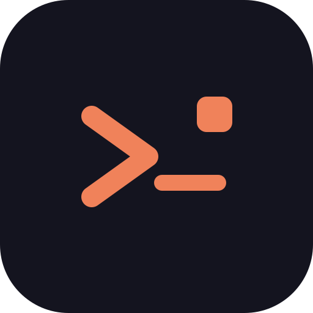
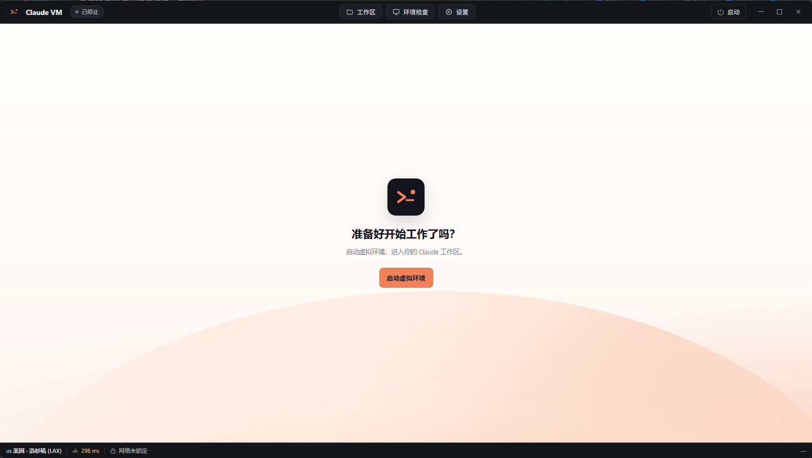

<div align="center">

<h1>ClaudeVM</h1>

**把 Claude 的工位搬进虚拟机，出网说断就断**



[](https://github.com/KeithMorning/ClaudeVM/releases) [](#构建桌面端) [](tests/README.md) [](LICENSE)

**[构建与安装](#构建桌面端) · [运行时镜像](#运行时镜像) · [技术文档](doc/index.md) · [测试体系](tests/README.md)**

</div>

## 受够了在本机折腾环境

作为一个只想安安静静写代码的正常用户，受够了在本机装代理、改系统设置、调时区语言、对着检测站的分数反复猜谜，还要担心哪一步留下直连。我们提出 **ClaudeVM**：**一个开箱即用的桌面程序，把串流桌面、Chrome、Claude Code 和出网内核一起放进隔离的 Linux 环境里。**

ClaudeVM 让你在熟悉的 Windows 上工作：点一次「启动」，串流桌面里已经有浏览器和终端；出网由容器内的 mihomo 内核经 TUN 全量接管，内核退出即断网；时区、系统语言与浏览器语言一次切好，不依赖宿主代理软件配合。支持以下几个重点功能：

- **串流桌面（唯一显示模式）**：TigerVNC + websockify + noVNC，只监听 `127.0.0.1`。
- **导入 YAML + 选择节点**：从 `proxies` 里选一个节点作为全量出口。
- **伪装画像**：中国台湾·台北 / 美国·洛杉矶两套，一次切换时区、语言与浏览器语言头。
- **原生桌面任务栏**：虚拟机里跑 tint2 面板，启动器、窗口任务项与时钟都是真实 X11 桌面的一部分；宿主不画假任务栏。
- **独立检查报告**：单独窗口渲染检测结果，不遮挡桌面、不影响使用。

**运行界面：**

| 启动前 | 运行中 |
| :---: | :---: |
| <a href="doc/images/ui-idle.png"></a> | <a href="doc/images/ui-running.png"></a> |

图中底部那行细的是**宿主侧状态信息**（地区 / 延迟 / 网络熔断 / 提示）；串流画面底部那条才是 **VM 内的 tint2 任务栏** —— 启动器与窗口任务项来自客机桌面，右侧时钟走 VM 自己的时区（`05:08 / Tue 17 Nov`），与宿主本机时间无关。

## 仓库结构

| 路径 | 说明 |
| --- | --- |
| `claude-desktop/` | Electron 桌面端：启动/停止、配置、检查报告、串流桌面、打包 |
| `claude-vm/` | Linux 运行时：Dockerfile、entrypoint、Rime 输入法、Openbox、网络守卫 |
| `build/` | 构建与排障脚本（产物与日志已由 `.gitignore` 排除） |
| `doc/` | **技术文档 wiki**：按主题拆分的架构/网络/桌面/工程/踩坑档案（**建议先看 [`doc/index.md`](doc/index.md)**） |
| `docs/` | 早期方案调研存档（如 WechatOnCloud） |
| `doc/images/` | README 界面截图 |

## 构建桌面端

```bash
cd claude-desktop
npm install
npm run dist:win     # Windows（NSIS 安装包）
npm run dist:mac     # macOS（dmg，必须在 Mac 上执行）
```

产物：`claude-desktop/dist/ClaudeVM-Setup-<version>-x64.exe`（Windows）。
macOS 上未签名的 dmg 首次打开需右键 →「打开」绕过 Gatekeeper。

## 运行时镜像

`rootfs.tar.gz`（约 650 MB）**不在仓库里**。它由 `claude-vm/vm/Dockerfile` 构建后导出，
内含 mihomo 内核与 GeoIP 数据库；应用首次启动时导入为运行时：
Windows 上是名为 `claude-vm` 的 **WSL2 发行版**，macOS 上是 **Docker / OrbStack 容器**。
构建与导出方法见 [`doc/engineering/01-构建与打包.md`](doc/engineering/01-构建与打包.md)；
macOS 细节见 [`doc/platform/02-macOS-容器后端.md`](doc/platform/02-macOS-容器后端.md)。

## 安全边界

- 容器内内核 + TUN 全量接管：应用无需显式代理，DNS / UDP / IPv6 一并被接管。
- 网络熔断：删除默认路由作为 fail-closed 底座；内核退出时 TUN 与策略路由一起消失，立刻全断。
- noVNC 只监听回环地址，不暴露到局域网。
- 宿主工作区通过 `/mnt` 挂载，登录态保存在虚拟磁盘内。

## 文档

- [doc/index.md](doc/index.md) — 技术文档 wiki 索引：架构、网络、桌面、平台、工程、安全、26 坑档案
- [doc/log.md](doc/log.md) — 文档变更日志
- [tests/README.md](tests/README.md) — 测试体系：分层、坑→测试映射、发版 checklist
- [claude-desktop/README.md](claude-desktop/README.md) — 应用侧功能与各版本修复说明
- [claude-vm/README.md](claude-vm/README.md) — 早期 Docker 方案存档

## 测试

```bash
node --test "tests/**/*.test.js"          # 全部（含 WSL 集成）
node --test "tests/unit/*.test.js" "tests/static/*.test.js"   # 快速层（无副作用）
```

单元（mock WSL）+ 静态一致性（两侧脚本逐字节比对）+ 集成（net-guard 锁定/解锁往返实测），详见 [tests/README.md](tests/README.md)。

## License

MIT
