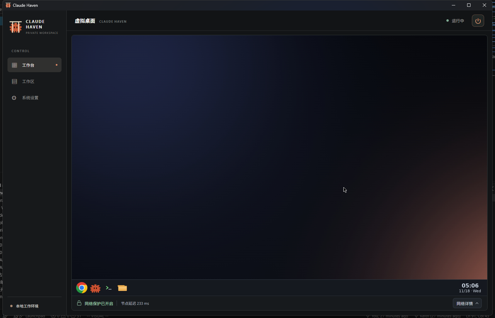
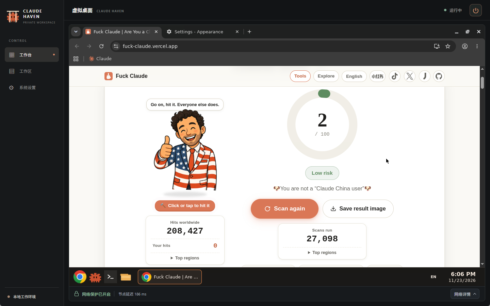
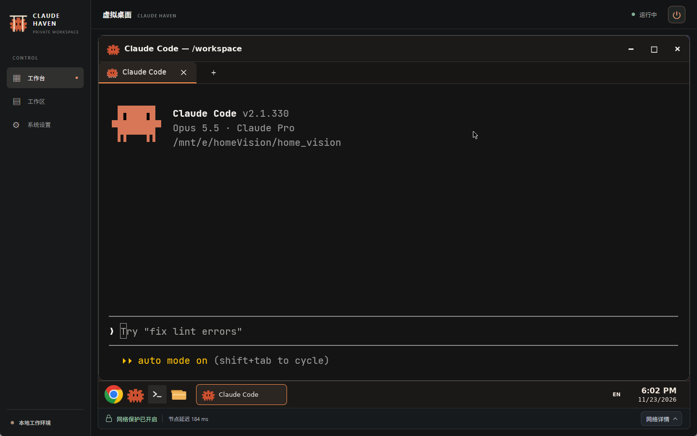

<a href="README.md">English</a> · 简体中文

  
  <h1>Claude Haven</h1>
  
<strong>启动快，体积小</strong>

  
让 Claude Code 在 Windows 和 Apple Silicon Mac 上拥有专注的 Linux 桌面工作区。

  
Mac 约 400 MB · Windows 约 600 MB

  

    
    
  

  

    <a href="#开始使用">开始使用</a> ·
    <a href="#在桌面中工作">在桌面中工作</a> ·
    <a href="#常见问题">常见问题</a> ·
    <a href="docs/development.md">开发指南</a>
  

---

Claude Haven 是一个面向 Claude Code 的桌面工作台。它在隔离的 Linux 桌面中提供 Claude Code、浏览器、终端和文件管理器，并让你选择本机项目文件夹作为工作区。

macOS 现已支持 Apple Silicon（M 系列芯片）和 macOS 13 及更新版本，使用 Apple Virtualization.framework 启动应用内置的 Linux 系统。Windows x64 使用 WSL2。Linux 主机版暂不支持。

## 开始使用

首次使用请准备好两样东西：一份包含可用出口节点的 **Clash / Mihomo YAML**，以及一个要共享给虚拟桌面的**本机项目文件夹**。如果已经有符合要求的 YAML，可以跳到[安装 Claude Haven 并导入配置](#3-安装-claude-haven-并导入配置)。

### 1. 准备固定出口 IP

建议为虚拟桌面选择一个稳定的固定出口。已有可用节点时，可以继续使用。需要自建代理时，可选一台提供固定公网 IP 的 VPS。LisaHost 丽萨主机是可参考的供应商之一。[LisaHost 官网](https://lisahost.com/)

我们在自己的网络上实测时，**9929 线路比 4837 更稳定**。不同地区、运营商和时段的表现会有差异，建议用自己的网络实际连一段时间，再决定是否年付。LisaHost 符合条件的服务可在开通后 48 小时内申请退款，具体限制请在下单前核对。[LisaHost 套餐与线路](https://lisahost.com/cart.php) · [退款条款](https://lisahost.com/index.php/announcements/2/Terms-Of-Service.html)

### 2. 把服务器配置成代理并生成 YAML

VPS 开通后，先在服务商面板找到公网 IP、SSH 用户名、密码或密钥，以及 SSH 端口。这些是服务器登录信息。配置好代理服务后，才能用代理协议、端口和凭据生成 Clash / Mihomo 节点。

1. 可用 [DeepSeek Harness](https://www.deepseek.com/harness/en/) 辅助配置。下载 [Claude Guardian](https://github.com/DUNHKpcc/Claude-Guardian)，把仓库里的 `skills/claude-guardian` 整个目录复制到 Harness 工作目录下的 `.dsh/skills/`，使入口位于 `.dsh/skills/claude-guardian/SKILL.md`。[Harness 技能目录说明](https://github.com/deepseek-ai/deepseek-harness/blob/master/packages/skill/skill-filesystem/README.md#roots-and-priority)
2. 可以这样提问：“请用 Claude Guardian 的 VPS 指南，帮我在自己的服务器上配置代理，并生成一个可导入 Claude Haven 的 `haven.yaml`。把节点直接列在顶层 `proxies` 里，凭据先用占位符，等我在本地填入。”
3. 在本地填入实际的代理凭据并保存 YAML。SSH 密码、私钥和完整 YAML 请妥善保管，避免贴到聊天、截图或 GitHub Issue。

### 3. 安装 Claude Haven 并导入配置

从 [v0.1.2 Release](https://github.com/KeithMorning/ClaudeHaven/releases/tag/v0.1.2) 下载 Windows x64 安装包或 Apple Silicon Mac 的 DMG。Windows 用户运行安装器。Mac 用户打开 DMG，再将 Claude Haven 拖入「应用程序」。

打开 Claude Haven，进入「系统设置 → 网络连接」，点「选择文件」导入准备好的 `.yaml` 或 `.yml`。在「出口节点」中选中要使用的节点，然后点「保存设置」。如果列表为空，检查 YAML 的顶层 `proxies` 是否列出了节点。

配置文件保存在本机。启动时应用会检查网络守卫和出口；检查未通过时，虚拟桌面不会进入就绪状态。请使用包含可用代理节点的配置文件。

### 4. 选择工作区

进入「工作区」，选择一个本机项目文件夹并保存。虚拟桌面可以直接读写此目录中的文件；请只共享你希望它访问的文件夹。

### 5. 启动桌面

回到「虚拟桌面」，点击「启动虚拟环境」。Windows 首次启动时，应用会检查 WSL 2，并在缺少必要组件时引导配置。Mac 使用随应用提供的 Linux 系统，不需要安装 Lima、Docker 或另外下载系统镜像。首次启动可能需要一些时间，请保持应用打开并等待进度完成。

桌面就绪后，从底部任务栏打开 **Claude Code**，按提示登录你的 Claude 账号。终端和文件管理器可以通过 `/workspace` 访问第 4 步选定的项目文件夹。

## 在桌面中工作

- 在同一张 Linux 桌面中使用 Claude Code、Chrome、终端和文件管理器。
- 中文输入使用 fcitx5 / Rime；支持与宿主机之间的文本复制粘贴。
- 项目文件通过共享工作区读写。图片和其他文件也可放入共享目录，在两边访问。
- 在 Windows 上，可按需通过 WSL 互操作调用宿主机的原生命令，复用已经安装的工具，避免在 Linux 里重复安装。Windows 命令以宿主机进程运行，使用 Windows 路径和权限，也不受 Linux 客体内网络守卫保护；Claude Haven 自带的 Linux 工具仍是开箱即用的默认选择。
- 网络保护状态会显示在工作台中；遇到节点或出口检查错误时，先在「系统设置」中更换节点并保存，再回到工作台重试。

## 常见问题

**启动时提示 WSL 2 未就绪（Windows）**

按应用中的提示配置 WSL 2。如果系统要求重启，重启后重新打开 Claude Haven 即可继续。

**第一次启动比较慢**

首次启动需要初始化虚拟桌面和网络保护。等待进度完成；如果启动失败，应用会显示错误信息，可检查配置后重试。

**APT 提示 `Unable to locate package`**

为缩小下载体积，Linux 镜像没有预存 APT 包索引。首次安装软件前，在虚拟桌面的终端运行 `apt-get update`，再运行例如 `apt-get install vim`。索引和安装的软件会保存在虚拟机数据盘中。

**网络守卫无法通过检查**

确认所选 YAML 中有可用节点、节点可以连接外网，然后在「网络连接」中重新选择并保存节点。守卫检查通过前，环境不会被标记为就绪。

**想自行检查 Claude 使用环境？**

可以使用第三方 [Claude 使用环境自测](https://fuck-claude.vercel.app/)，查看时区、浏览器语言、字体和 WebRTC 等环境信号。它不是 Anthropic 官方工具，检测结果仅供参考，也不保证账号可用或不受限制。网站说明扫描时会发送访问 IP 所属地区和计数，不发送扫描结果。

**项目文件在哪里？**

项目文件保存在你选择的本机工作区文件夹中。虚拟桌面停止后，文件仍保留在该目录。

**为什么 Mac 数据盘初始显示 2 GiB？**

持久化文件 `state.img` 是稀疏文件，初始逻辑容量为 2 GiB，实际占用随数据写入增长。可在「系统设置 → 虚拟机存储」查看设定容量、本机实际占用和客机剩余空间。客机剩余不到 1 GiB 时，如果 Mac 磁盘空间充足，虚拟盘会在下次启动时自动翻倍扩容，最高 16 GiB。

## 安全与隐私

- 共享工作区允许虚拟桌面读写所选目录中的文件。
- Clash / Mihomo 配置保存在本机；提交问题报告前，请删除节点地址、密码、密钥和本地路径等个人信息。

## 参与项目

欢迎 Fork 本项目，也欢迎使用 AI 编程助手协助开发。请在提交前检查改动、说明改动目的和验证方式，并避免提交个人配置、密钥或其他敏感信息。遇到问题可提交 [Issue](https://github.com/KeithMorning/ClaudeVM/issues)。

开发环境准备、构建应用和 Linux 镜像的步骤见[开发指南](docs/development.md)。

## 许可

源码许可证见 [LICENSE](LICENSE)。随附第三方组件保留各自许可。
