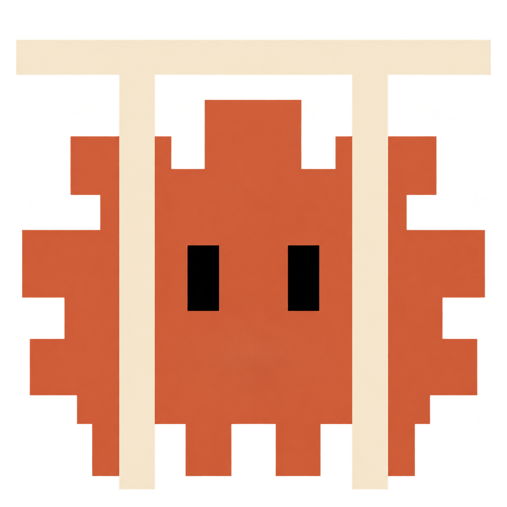

<a href="README.md">English</a> · 简体中文

  
  <h1>Claude Haven</h1>
  
<strong>启动快，体积小</strong>

  
让 Claude Code 在 Windows 和 Apple Silicon Mac 上拥有专注的 Linux 桌面工作区。

  
Mac 约 400 MB · Windows 约 600 MB

  

    
    
  

  

    <a href="#开始使用">开始使用</a> ·
    <a href="#在桌面中工作">在桌面中工作</a> ·
    <a href="#常见问题">常见问题</a> ·
    <a href="docs/development.md">开发指南</a>
  

---

Claude Haven 是一个面向 Claude Code 的桌面工作台。它在隔离的 Linux 桌面中提供 Claude Code、浏览器、终端和文件管理器，并让你选择本机项目文件夹作为工作区。

macOS 现已支持 Apple Silicon（M 系列芯片）和 macOS 13 及更新版本，使用 Apple Virtualization.framework 启动应用内置的 Linux 系统。Windows x64 使用 WSL2。Linux 主机版暂不支持。

## 开始使用

### 1. 下载并安装

前往 [GitHub Releases](https://github.com/KeithMorning/ClaudeVM/releases/latest)，下载与你的平台对应的安装包：Windows x64 安装包，或 Apple Silicon Mac 的 DMG。Mac 用户打开 DMG 后，将 Claude Haven 拖到 `Applications` 快捷方式中。

### 2. 配置网络

首次打开应用后，进入「系统设置」：

1. 在「网络连接」中选择本机的 Clash / Mihomo YAML 配置文件。
2. 从配置里的节点列表选择一个出口节点，然后保存。

配置文件保存在本机。启动时应用会检查网络守卫和出口；检查未通过时，虚拟桌面不会进入就绪状态。请使用包含可用代理节点的配置文件。

### 3. 选择工作区

进入「工作区」，选择一个本机项目文件夹并保存。虚拟桌面可以直接读写此目录中的文件；请只共享你希望它访问的文件夹。

### 4. 启动桌面

回到「虚拟桌面」，点击「启动虚拟环境」。Windows 首次启动时，应用会检查 WSL 2，并在缺少必要组件时引导配置。Mac 使用随应用提供的 Linux 系统，不需要安装 Lima、Docker 或另外下载系统镜像。首次启动可能需要一些时间，请保持应用打开并等待进度完成。

## 在桌面中工作

- 在同一张 Linux 桌面中使用 Claude Code、Chrome、终端和文件管理器。
- 中文输入使用 fcitx5 / Rime；支持与宿主机之间的文本复制粘贴。
- 项目文件通过共享工作区读写。图片和其他文件也可放入共享目录，在两边访问。
- 网络保护状态会显示在工作台中；遇到节点或出口检查错误时，先在「系统设置」中更换节点并保存，再回到工作台重试。

## 常见问题

**启动时提示 WSL 2 未就绪（Windows）**

按应用中的提示配置 WSL 2。如果系统要求重启，重启后重新打开 Claude Haven 即可继续。

**第一次启动比较慢**

首次启动需要初始化虚拟桌面和网络保护。等待进度完成；如果启动失败，应用会显示错误信息，可检查配置后重试。

**网络守卫无法通过检查**

确认所选 YAML 中有可用节点、节点可以连接外网，然后在「网络连接」中重新选择并保存节点。守卫检查通过前，环境不会被标记为就绪。

**想自行检查 Claude 使用环境？**

可以使用第三方 [Claude 使用环境自测](https://fuck-claude.vercel.app/)，查看时区、浏览器语言、字体和 WebRTC 等环境信号。它不是 Anthropic 官方工具，检测结果仅供参考，也不保证账号可用或不受限制。网站说明扫描时会发送访问 IP 所属地区和计数，不发送扫描结果。

**项目文件在哪里？**

项目文件保存在你选择的本机工作区文件夹中。虚拟桌面停止后，文件仍保留在该目录。

**为什么 Mac 数据盘显示有 2 GB？**

持久化文件 `state.img` 的逻辑容量是 2 GB，但它是稀疏文件。创建时不会预先占满 2 GB 的物理磁盘空间，实际占用会随着虚拟桌面写入数据逐渐增长。

## 安全与隐私

- 共享工作区允许虚拟桌面读写所选目录中的文件。
- Clash / Mihomo 配置保存在本机；提交问题报告前，请删除节点地址、密码、密钥和本地路径等个人信息。

## 参与项目

欢迎 Fork 本项目，也欢迎使用 AI 编程助手协助开发。请在提交前检查改动、说明改动目的和验证方式，并避免提交个人配置、密钥或其他敏感信息。遇到问题可提交 [Issue](https://github.com/KeithMorning/ClaudeVM/issues)。

开发环境准备、构建应用和 Linux 镜像的步骤见[开发指南](docs/development.md)。

## 许可

源码许可证见 [LICENSE](LICENSE)。随附第三方组件保留各自许可。
